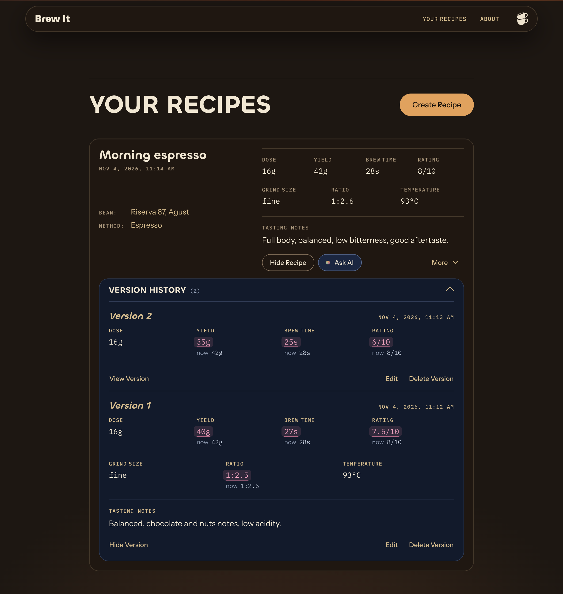
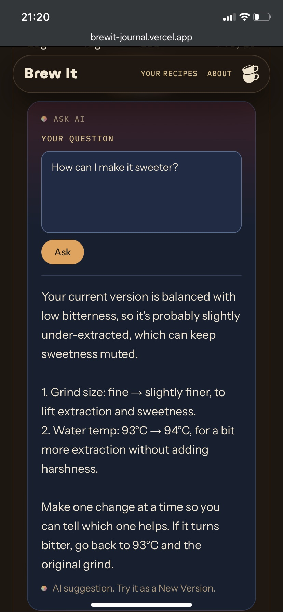
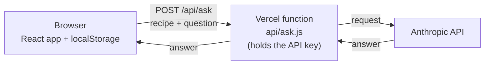

#  Brew It

Save your coffee recipes and keep every version as you experiment.

**[Live demo](https://brewit-journal.vercel.app)** · [LinkedIn](https://www.linkedin.com/in/roey-madjar)

<p align="center">
  
  &nbsp;
  
</p>

## About

Home brewers tweak dose, grind and yield from cup to cup, and it's easy to forget what worked.
Brew It starts with a detailed recipe: bean, method, dose, grind, temperature, brew time, yield, rating and tasting notes.
Every time you tweak it, you save a new version. Old versions stay in the history, and every value that differs from what you brew now is highlighted.

## Try it

The demo starts empty, so create a recipe first:

1. Open the [live demo](https://brewit-journal.vercel.app) and click **Create Recipe**.
2. Open **More → New Version** and change the grind or yield.
3. Open **Version History**: the old version shows what changed compared to now.
4. Click **Ask AI** and ask "How can I make it less bitter?"

Your recipes are saved only in your browser.

## Features

- **Recipes with versions:** save a new version for each experiment; the full history is kept.
- **Edit vs. New Version:** fix a typo without creating a new entry, or record a real change as a version.
- **Comparison highlighting:** old versions mark every value that differs from the current one ("now 42g").
- **Ask AI:** ask a question about one recipe and get a short, practical suggestion to try as a new version.
- **Saved in the browser:** no account or sign-up; data lives in `localStorage`.
- **Responsive and accessible:** works on phones and desktop, keyboard and screen-reader friendly, respects reduced motion.

## Tech stack

| Area     | Technology                                         |
| -------- | -------------------------------------------------- |
| Frontend | React 19, JavaScript, Vite 8                       |
| Styling  | Plain CSS                                          |
| Storage  | `localStorage`                                     |
| Backend  | One Vercel serverless function                     |
| AI       | Anthropic Claude API, called with plain `fetch`    |
| Tooling  | ESLint                                             |
| Hosting  | Vercel                                             |

No routing, UI or state libraries, by choice: the app stays small enough to manage with React alone.

## Architecture



Recipes never leave the browser, except the one recipe sent with an Ask AI question.

## Technical decisions

- **One state value for the open form.** `activeForm` holds which form is open (create, edit, new version), so two forms can never be open at once. Ask AI uses the same idea: one `status` (`idle` / `loading` / `error` / `success`) instead of several booleans.
- **Derived values are never stored.** The ratio (yield ÷ dose) and the recipe order are calculated on render, so they can't get out of sync with the data.
- **Old versions are compared to the current one, not to the previous one.** The useful question is "which old values match what I brew now?"
- **Edit and New Version are different actions.** Edit corrects a recorded value; New Version records a new experiment. Dates are never changed.
- **The API key stays on the server.** The browser only calls `/api/ask`. Question length, recipe size and answer length are capped, and a monthly spend limit caps the cost.
- **Empty fields are `null`, not `0`.** A `0` would look like a real measurement; empty fields show as "—".

## Project structure

```
api/
  ask.js            Serverless function: validates input, calls the Anthropic API
src/
  App.jsx           App state, handlers, localStorage load/save
  components/       UI components (recipe form, version history, Ask AI, header…)
  utils/            Pure helpers: formatting, comparison, form conversion, animation timing
  styles/           Design system CSS (tokens, components, site layout)
design/             Design snapshot and reference markup
public/             Logo, favicon, fonts
```

## Getting started

Requires **Node.js 20.19+ or 22.12+**.

```bash
git clone https://github.com/RoeyMadjar/Brew-It.git
cd Brew-It
npm install
npm run dev        # http://localhost:5173
```

`npm run dev` runs everything except Ask AI. To run Ask AI locally, you need the [Vercel CLI](https://vercel.com/docs/cli) and an [Anthropic API key](https://console.anthropic.com):

```bash
npm install -g vercel
echo "ANTHROPIC_API_KEY=your-key-here" > .env
vercel dev         # http://localhost:3000 (app + /api)
```

On first run, `vercel dev` asks to link the folder to a Vercel project. `.env` is gitignored.

Other scripts: `npm run lint`, `npm run build`, `npm run preview`.

## Limitations & roadmap

**Current limitations**

- Recipes are saved in one browser only: no accounts, no sync between devices.
- No automated tests yet.

**Coming next**

1. Search bar for recipes
2. Create with AI: describe your coffee preferences and get a recipe to review and save

## Acknowledgements

- Built with [Claude Code](https://claude.com/claude-code) as a pair programmer and designed with Claude Design. I planned each feature, reviewed and approved every change, and tested everything myself. The workflow rules are in [CLAUDE.md](CLAUDE.md).
- Fonts: [Chillax](https://www.fontshare.com/fonts/chillax) by Indian Type Foundry (Fontshare); Archivo, Instrument Sans and IBM Plex Mono (Google Fonts).

## License

The code is licensed under the [MIT License](LICENSE).
The Chillax font files (`public/fonts/`, `design/fonts/`) are not covered by MIT; they are distributed under the ITF Free Font License from Fontshare.

## Author

**Roey Madjar**, junior frontend developer

[LinkedIn](https://www.linkedin.com/in/roey-madjar) · [GitHub](https://github.com/RoeyMadjar) · [roeymadjar100@gmail.com](mailto:roeymadjar100@gmail.com)
